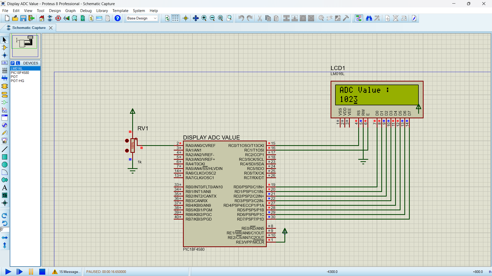

# PIC18F4580 ADC Interfacing

## 📌 Overview
This project demonstrates Analog-to-Digital Converter (ADC) interfacing using the PIC18F4580 microcontroller and Embedded C.

## 🎯 Objectives
- Understand the ADC peripheral of the PIC18F4580.
- Configure ADC registers and analog input channels.
- Read analog voltage values using the ADC.
- Display or process the converted values, depending on the application.

## 🛠️ Hardware and Software
- **Microcontroller:** PIC18F4580
- **Programming language:** Embedded C
- **IDE/Compiler:** Add the actual tool you used
- **Simulation:** Proteus ISIS

## ⚙️ Working Principle
The ADC converts an analog input voltage into a digital value that the microcontroller can process. The result depends on the ADC resolution, reference voltage, and configuration.

## 📚 Concepts Practiced
- ADC configuration registers
- Analog input channel selection
- ADC conversion and result registers
- Embedded C programming

## 🔌 Circuit Diagram

## 👨‍💻 Author
Piyush Gondane
